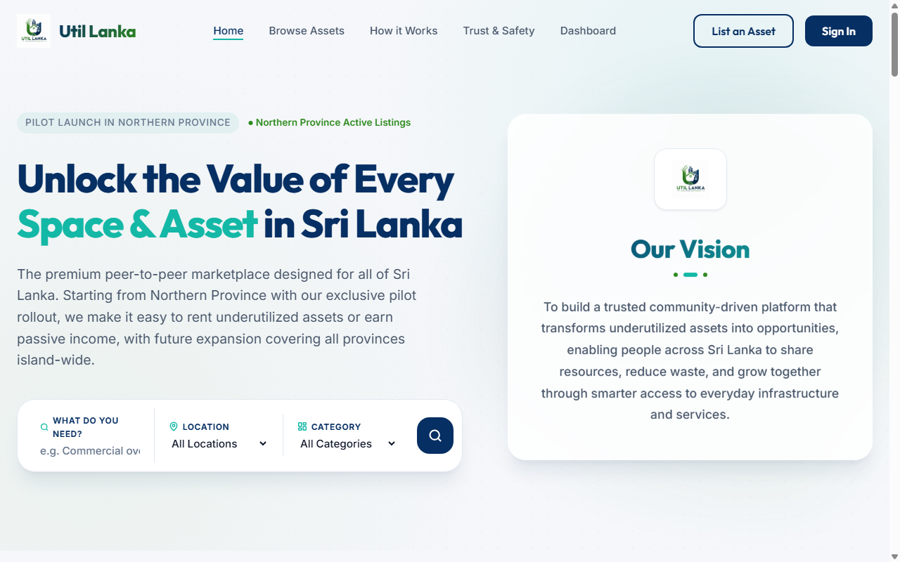
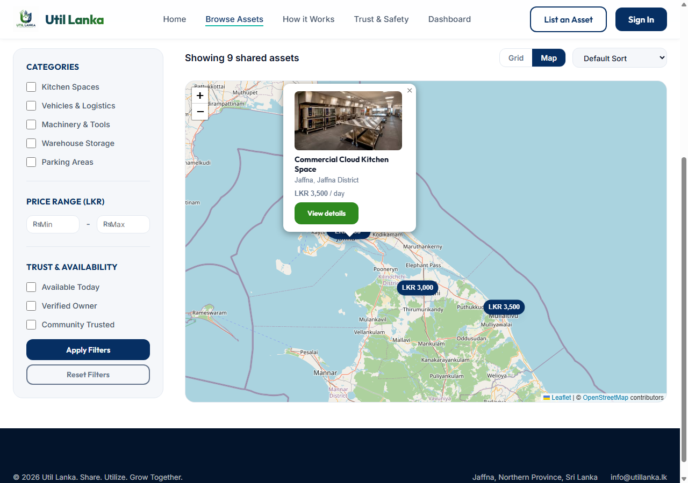
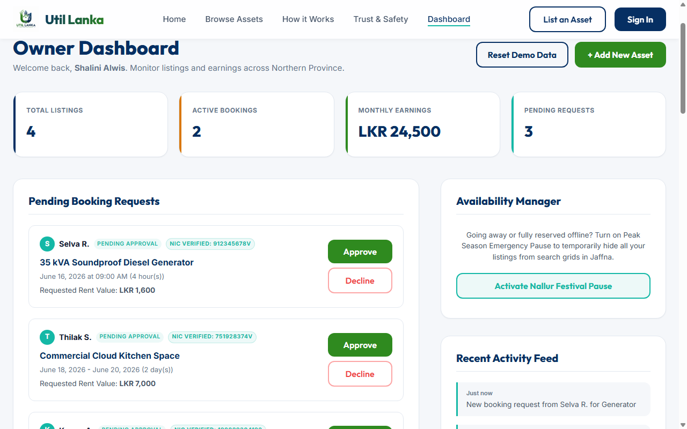

# Util Lanka

**A peer-to-peer marketplace for renting out under-used assets in Sri Lanka**: kitchens, vehicles, equipment, storage rooms and parking spaces. Owners earn from things that would otherwise sit idle, and small businesses get affordable access to what they need. The pilot covers the Northern Province.



## Features

- **Browse and search** listings by keyword, category, price, trust labels and **district or town** (Jaffna, Kilinochchi, Mannar, Mullaitivu and Vavuniya districts).
- **Map view** showing listings as price pins on an OpenStreetMap map, filtered by the current search.
- **Listing details** with a photo gallery, specs, host profile and reviews.
- **Daily or hourly booking**, with a cost breakdown (rental, 5% platform fee, refundable deposit) and Sri Lankan NIC format checks at checkout.
- **List an asset** with up to 3 photos. New listings show up immediately across the site.
- **Owner dashboard** where hosts approve or decline booking requests and track their listings, earnings and activity.
- **Reset Demo Data** button that returns the app to its starting data.

| Map view | Owner dashboard |
| --- | --- |
|  |  |

## Try it

There is no build step and nothing to install.

1. Clone the repo:
   ```bash
   git clone https://github.com/Pavithira-R/util-lanka-mvp.git
   ```
2. Open `index.html` in a browser, or serve the folder with any static server, such as the VS Code **Live Server** extension.

The map loads Leaflet and the map tiles from the internet. Everything else works offline.

### Suggested walkthrough

1. On the home page, click **List an Asset**, fill in the form, add a photo and publish.
2. Open **Browse Assets**, switch to **Map**, and find your listing.
3. Click **Book Now** on any listing and send a request.
4. Open the **Dashboard**. Your listing is under *My Listings* and your request is under *Pending Booking Requests*. Approve it and watch the earnings update.
5. Click **Reset Demo Data** to start over.

## How it works

This is a front-end prototype: plain HTML, CSS and JavaScript with no framework and no backend.

| File | Purpose |
| --- | --- |
| `data.js` | Shared data and helpers used by every page: seed listings, districts and towns, saving listings and booking requests |
| `app.js` | Home page |
| `marketplace.js` | Browse Assets: search, filters, sorting, map view |
| `details.js` | Listing details page |
| `checkout.js` | Booking checkout |
| `dashboard.js` | Owner dashboard |
| `upload.js` | Photo upload for new listings |
| `styles.css` | Shared styles |

New listings, booking requests and dashboard state are saved in the browser's `localStorage`, so they stay on the device and browser where they were created. A production version would need a backend with user accounts, server-side pricing and payments.

## Credits

- **Original app:** built by [Arankan05](https://github.com/Arankan05) for a hackathon ([original repository](https://github.com/Arankan05/util-lanka-mvp)).
- **Further development:** by [Pavithira-R](https://github.com/Pavithira-R):
  - shared data layer
  - new listings that are saved with their photos
  - fix for the *List an Asset* button on the home and browse pages
  - booking requests that reach the dashboard, including fixed hourly booking
  - district search and the map view
  - demo reset

Map data © [OpenStreetMap](https://www.openstreetmap.org/copyright) contributors, displayed with [Leaflet](https://leafletjs.com/).
